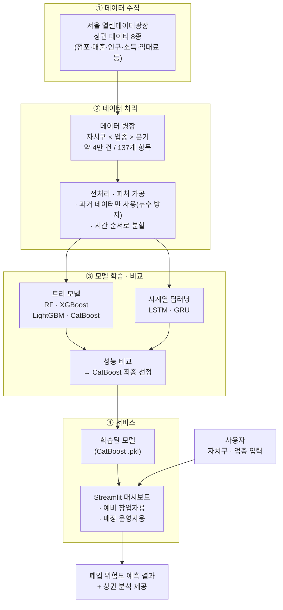

# 장효정 | AI Engineer Portfolio

**이미지 처리와 AI 모델 개발·검증 경험을 갖춘 AI 엔지니어입니다.**

기계공학 전공을 바탕으로 데이터 분석부터 AI 모델 개발, 성능 평가 및 서비스 구현까지 경험했습니다.

---

## Key Projects

### 1. AI 기반 특허 검색·멀티모달 RAG 챗봇

- **주요 내용:** OpenCV 기반 도면 특징점 추출·유사도 비교 및 RAG 기반 특허 검색·질의응답 시스템 구현
- **핵심 역량:** 이미지 전처리, 특징 추출, 유사도 검색, 검색 결과 검증
- 🔗 [Project Repository](https://github.com/HyojungJ/Vision-Patent-Search-LLM-Chatbot)

### 2. AI 기반 밈 숏폼 광고 영상 자동 생성 플랫폼

- **주요 내용:** LLM 파인튜닝, 이미지·영상 생성물 품질 검증 및 자동 재생성 파이프라인 구현
- **핵심 역량:** AI 모델 연동, 생성 결과 검증, 서비스 개발 및 배포
- 🔗 [Project Repository](https://github.com/HyojungJ/AI-Meme-Shorts-Ad-Generator)

### 3. 서울시 자치구·업종별 매장 폐업 위험 예측

- **주요 내용:** CatBoost 등 6개 모델의 성능 비교 및 데이터 누수 개선, LSTM·GRU 기반 시계열 예측 확장
- **핵심 역량:** 데이터 전처리, 모델 학습·평가, 성능 비교 및 검증
- 🔗 [Project Repository](https://github.com/HyojungJ/Seoul-Store-Closure-Prediction)

